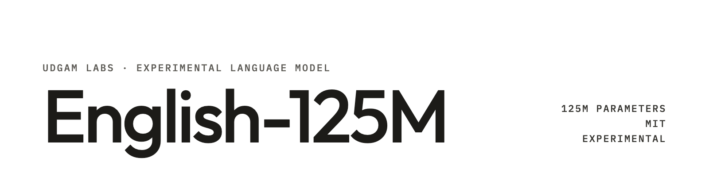

**UDGAM LABS** · Experimental language model · 125M parameters

# Udgam English 125M

**v0.1.0 · An open English model experiment from Udgam Labs**

We trained a 125,829,314-parameter model from random weights and built our own 16,384-token tokenizer. The release includes a base model, a conversation-tuned variant, offline inference, a local fine-tuning tool, the training recipe and the negative results. Udgam Labs is based in India and builds for a global audience.

**The performance target failed.** This recipe did not beat Sarvam-1 or the smaller SmolLM2 baselines. It is a research artifact, not a reliable general assistant.

[Download models on Hugging Face](https://huggingface.co/udgamlabs/udgam-english-125m/tree/v0.1.0) · [Complete distribution ZIP](https://github.com/udgamlabs/udgam-english-125m/releases/tag/v0.1.0) · [Udgam Labs](https://www.udgamlabs.com/)

## Results we are releasing

| Model | Fixed 2,500-item macro accuracy |
|---|---:|
| Udgam English 125M base | **45.72%** |
| Udgam English 125M conversation | **46.40%** |
| Sarvam-1 | 68.08% |
| SmolLM2-135M | 51.76% |
| SmolLM2-360M | 57.40% |

Every model was evaluated on the same 500 items per task: ARC-Challenge, HellaSwag, PIQA, BoolQ and WinoGrande. The first three use normalized accuracy, the last two accuracy; the macro weights tasks equally. These are a frozen selected suite, not full official leaderboard results. Both owned variants failed all task floors and the 52% macro floor. Both passed **0/24 strict automatic instruction diagnostics**; 12 human-rubric items per variant remain unscored. All six fixed comparisons are retained. No Pareto-frontier or reliable-assistant claim follows from this experiment.

Read the [full results](release/research/EXPERIMENT_RESULTS.md), [frozen protocol](release/research/evaluation_protocol.md), and [per-item outcomes and comparisons](release/results/README.md). Some instruction responses were relevant but failed exact formatting; others contained substantive errors and repetition.

## Where it falls short

All numbers are from the table above. Both variants are behind every baseline on the 2,500-item macro: base 45.72% and
conversation 46.40%, against 51.76% for SmolLM2-135M, 57.40% for SmolLM2-360M and 68.08% for Sarvam-1. Both failed all
five task floors and the 52% macro floor, and passed 0/24 strict automatic instruction checks.

## Run a model

**This Git checkout contains source and documentation, not the two `model.pt` files.** Obtain the complete repository snapshot at tag `v0.1.0` from Hugging Face, or the original sealed ZIP from the GitHub release. The GitHub-generated source-code ZIP is also source-only.

From the complete downloaded distribution, enter the folder containing `SHA256SUMS`, `models/` and `tools/`. This is `release/` in the Hugging Face snapshot. In an isolated Python environment:

```sh
# macOS; on Linux use: sha256sum -c SHA256SUMS
shasum -a 256 -c SHA256SUMS
python -m pip install -r models/base/requirements.txt
python models/base/infer.py --device cpu --prompt "A useful way to check an explanation is" --max-new-tokens 64
python models/conversation/infer.py --device cpu --chat --max-new-tokens 64
```

The complete distribution's `RELEASE_MANIFEST.json` SHA256 is:

```text
13f9eff874e58c8bbf10d8bf14959a9aece76a7be10a764b1fb10439f9bdfa40
```

The source-only checkout intentionally cannot pass the complete-distribution checksum check until the missing weights are supplied. Each native loader separately verifies its model inventory. Native inference is offline PyTorch with the owned tokenizer and bundled source; it requires no hosted API, training optimizer or external base model. It is not a Transformers, GGUF or quantized release. The context is 2,048 tokens including prompt and response. Both exports passed fresh-process CPU loads; the verified local environment used PyTorch 2.11, while cloud training/evaluation used PyTorch 2.9.1/CUDA.

## Adapt it and inspect the recipe

The [local fine-tuning guide](release/research/FINETUNE_NATIVE.md) accepts ordinary JSONL prompt/response pairs and writes a separate native model. It passed tiny CPU fixtures and a one-update integration check on the actual 125M base. Full-pass resource needs and CUDA adaptation are unmeasured. An adaptation has new weight hashes and must be evaluated separately.

The [training recipe](release/research/REPRODUCE_ENGLISH_125M.md) records 2,033,549,312 pretraining targets and one finite OASST2 pass over 7,237 examples. No pretrained model weights or tokenizer vocabulary initialized the model. The recipe reuses nanochat code and public data, including disclosed synthetic text; it is not an independently invented architecture or teacher-free corpus.

Source, configurations, upstream notices, data revisions and public scientific summaries are available under `release/`. Historical cloud training is documented but is **not turnkey reproduction**: it needs the pinned public inputs, prepared provenance, compatible hardware and real provider controls. Do not fabricate historical guard records. Local inference and the additive fine-tuning tool are independent of that historical cloud setup.

## Cost and verification

The retained **24 September 2026, 17:18 UTC** observation was **US$16.58 gross cloud usage**, with **US$0 Modal paid charges**, using credits. Cleanup/access revocation and storage/transfer settlement were still pending then. This is a dated observation, not a final bill or a current balance; Mac hardware, internet and engineering time are unpriced. See the [cost record](release/PUBLIC_COST_SUMMARY.json).

Both exports match their checkpoints tensor for tensor. The full sealed input and returned lineage passed private portable validation; the only arithmetic allowance is at most four binary64 ULP for recomputed positive finite historical learning rates. Stored records and all other checks remain exact. The [public summary](release/PUBLIC_SCIENTIFIC_PROVENANCE.json) references the original private proof by hash.

The files under `release/` preserve the sealed 24 September snapshot unchanged, apart from omitting the two weights in this source checkout. Statements inside that snapshot that publication had not occurred are historical. This top-level README and the v0.1.0 notes describe the public distribution.

## License and contribution

Udgam-written code, documentation, tokenizer and owned weights use **MIT** terms. Upstream code and third-party data retain their notices and terms; see [license scope](release/LICENSE_SCOPE.md), [data attribution](release/research/data_sources.json) and the model attribution folders. MIT does not relicense the source corpora or baseline models. Raw corpora, per-example training traces, baseline weights, optimizer backups, credentials and account records are excluded.

We welcome reproducible bug reports and independent improvements. Remove personal information from examples. Changed weights need new identities and fresh evaluation; this release's benchmark scores do not transfer to them. The original experiment did not meet its target, and that result remains part of the record.

---

**About Udgam Labs.** Udgam Labs is an independent AI research lab. We work from first principles: before we build, we understand why things work, whether we are training a model, fine-tuning one or applying AI to a new problem. Udgam (उद्गम) is Sanskrit for origin. [udgamlabs.com](https://udgamlabs.com)
